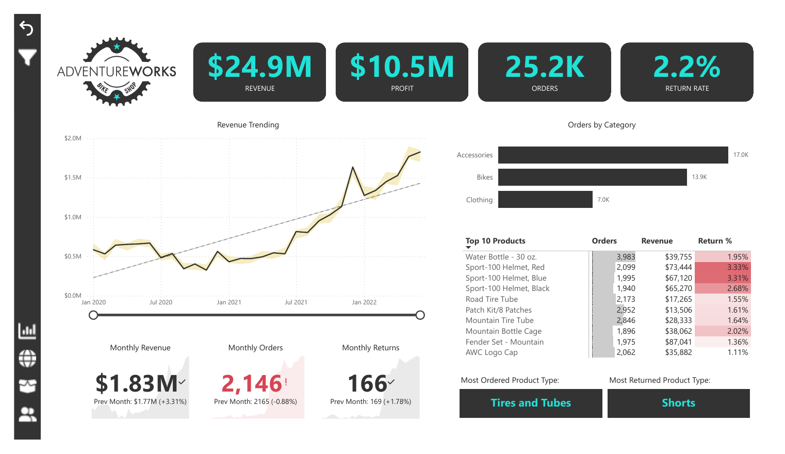
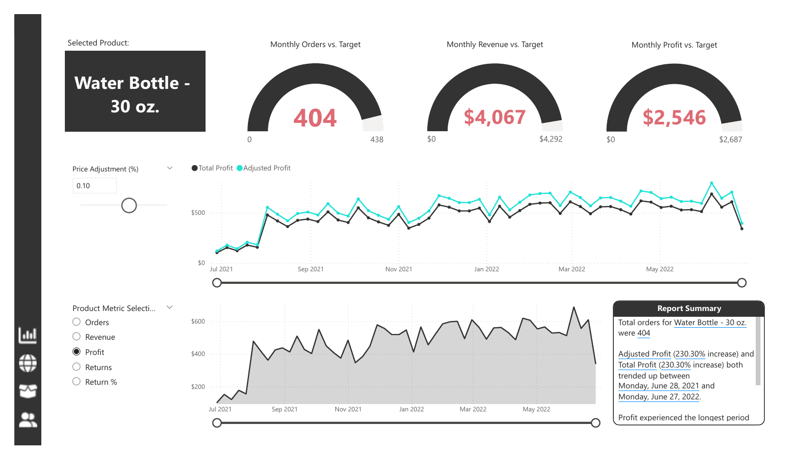
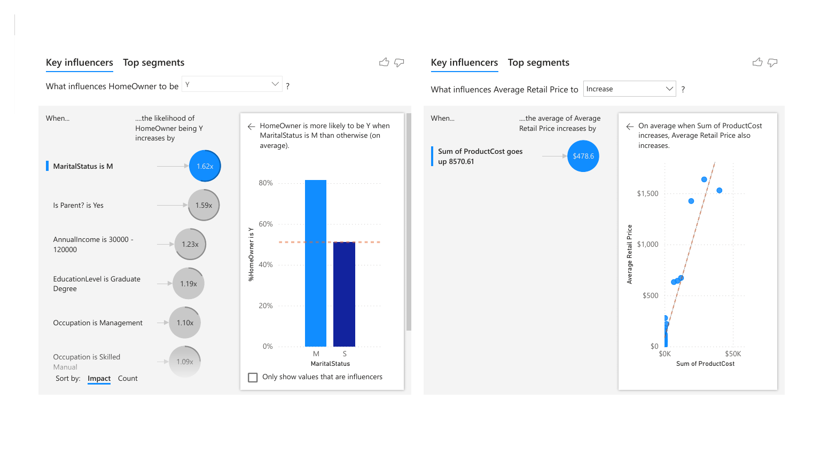

# AdventureWorks Sales & Marketing Dashboard (Power BI)

An interactive Power BI report for a bike and accessories retailer. It tracks revenue, profit, orders and returns, lets managers drill into any product, and shows which customer groups drive sales. Built on the AdventureWorks sample data (2020–2022).

## Business problem

Sales and marketing managers need one place to answer:

- Are revenue, orders and returns going up or down compared with last month?
- Which products sell the most, and which come back the most?
- Is each product hitting its monthly targets, and what happens to profit if we change the price?
- Who are our best customers, and what do they have in common?

## Report pages

| Page | What it shows |
|---|---|
| **Executive dashboard** | KPI cards (revenue, profit, orders, return rate), revenue trend with trend line, orders by category, top 10 products with return %, month-over-month cards |
| **Map** | Sales by region (Europe, North America, Pacific) |
| **Product detail** | Gauges for orders, revenue and profit vs. target; a **what-if price slider** that recalculates profit; metric selector; auto-generated smart narrative |
| **Customer detail** | Orders by income level and occupation, top 100 customers, top customer callout |
| **Decomposition tree** | Orders broken down by category, subcategory and product |
| **Q&A** | Ask questions in plain English ("total orders by country") |
| **Category tooltip** | Custom tooltip page shown when hovering over a category |
| **Key influencers** | AI visual showing what makes a customer more likely to own a home and what drives retail price |

## Key insights

| Metric | Value |
|---|---|
| Revenue | **$24.9M** |
| Profit | **$10.5M** |
| Orders | **25.2K** |
| Return rate | **2.2%** |

- Revenue roughly tripled from early 2020 to mid-2022, with a sharp step up in mid-2021.
- **Accessories** drive the most orders (17.0K) but **bikes** drive most of the revenue.
- Helmets have the highest return rates in the top 10 (about 3.3%); shorts are the most returned product type.
- Married customers are **1.62×** more likely to own a home, and parents **1.59×** more likely. Useful for targeting campaigns.

| Product detail | Key influencers |
|---|---|
|  |  |

## Power BI features used

- **Data modelling:** star schema with two fact tables (Sales, Returns) and lookup tables for customers, products, subcategories, categories, calendar and territories; a dedicated measure table
- **DAX:** KPI measures, previous-month comparisons, return rate, order/revenue/profit targets and gaps, adjusted profit from a what-if price parameter
- **Interactivity:** navigation buttons, slicers, bookmarks, a custom tooltip page, and field parameters to switch the metric shown on product and customer pages
- **AI features:** key influencers, decomposition tree, Q&A, smart narrative and anomaly detection on the revenue trend
- **Design:** consistent dark theme, conditional formatting on return %, KPI cards with trend indicators

## Files

| File | Description |
|---|---|
| `AdventureWorks_Report.pbix` | The Power BI report (open in Power BI Desktop) |
| `AdventureWorks_Report.pdf` | PDF export of all pages, for viewing without Power BI |
| `images/` | Screenshots used in this README |

## How to open

1. Install [Power BI Desktop](https://powerbi.microsoft.com/desktop/) (free, Windows).
2. Download `AdventureWorks_Report.pbix` and open it.
3. No Power BI? Open `AdventureWorks_Report.pdf` instead.

## What I would improve next

- Publish to Power BI Service with scheduled refresh and row-level security by region
- Add a returns-analysis page with reasons and cost of returns
- Replace static targets with a forecast

## Author

**Omkar Gokhale** — Microsoft Certified Power BI Data Analyst (PL-300) · [GitHub](https://github.com/Omkyao1998)
